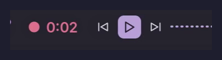

# Snipcast

Record a **region** of the screen from the [Noctalia](https://noctalia.dev) bar and
get the finished file straight on the clipboard — so sending a clip to a chat is
the same gesture as sending a screenshot: click, drag, click, **Ctrl+V**.



- ✂️ **Region first** — every recording starts with a `slurp` drag. No portal
  dialog, no window picker, no "share your entire screen" prompt.
- 🔇 **Never any audio** — `wf-recorder` is invoked without `-a`, so the mp4 has no
  audio stream at all. That is what makes **Telegram play it as a looping GIF**
  instead of showing a video player.
- 📋 **Straight to the clipboard** — the saved file is offered as `text/uri-list`,
  the format a file manager uses for a copied file, so chat clients paste it as an
  attachment.
- ⏱ **A timer on the bar** — the only reliable cue that a region tucked away in a
  corner is still recording.
- ⌨️ **Drivable from a keybinding** — the capture lives in a headless service, so
  it works with no widget on the bar.

## Requirements

- Noctalia **5+**
- A compositor with `wlr-screencopy` (anything `grim` works on: niri, Hyprland,
  Sway, river, …)
- [`wf-recorder`](https://github.com/ammen99/wf-recorder) and
  [`slurp`](https://github.com/emersion/slurp) on `PATH`

## Install

```bash
noctalia msg plugins source add Snipcast git https://github.com/werdin/snipcast
noctalia msg plugins update Snipcast   # fetch the source
noctalia msg plugins enable werdin/snipcast
```

> If the plugin doesn't appear right after adding the source, restart Noctalia so
> it fetches the new git source, then run the `enable` command.

Then add the **Snipcast** widget to a bar from Noctalia's **widget picker**
(Settings → Bar → *+ Add widget*). Adding it through the picker is what attaches
the settings gear (⚙) — a hand-edited bar entry renders but has no settings.

## Updating

```bash
noctalia msg plugins update Snipcast            # source name, see below
noctalia msg plugins disable werdin/snipcast
noctalia msg plugins enable  werdin/snipcast
```

> ⚠️ The argument to `plugins update` is the **source** name you passed to
> `source add`, and it is case-sensitive. With a name that doesn't match, Noctalia
> still answers `ok (updating in background)` but fetches nothing — so a new
> setting silently fails to show up. Check the exact spelling with
> `noctalia msg plugins source list`, and confirm the new version landed with
> `noctalia msg plugins list | head -1`.

## Usage

| Action | Behavior |
| --- | --- |
| Left click | Pick a region and start recording — or stop the running one. |
| Right click | Record the whole focused output, skipping the region picker. |
| Middle click | Stop and throw the file away. |

Pressing <kbd>Esc</kbd> (or right-clicking) during the `slurp` drag cancels
quietly — cancelling is a normal outcome, not an error.

When the recording stops, the file is written to the configured folder, a
notification names it, and — unless you turn `copy_to_clipboard` off — it is put
on the clipboard. In Telegram, Mattermost, Discord or any GTK/Qt chat client,
<kbd>Ctrl</kbd>+<kbd>V</kbd> then attaches it.

### Keybinding

The capture runs in a headless service, so it can be driven with no widget placed:

```sh
noctalia msg plugin werdin/snipcast:service all toggle
```

niri, as a counterpart to a region-screenshot binding:

```kdl
binds {
    "Mod+Shift+R" { spawn "noctalia" "msg" "plugin" "werdin/snipcast:service" "all" "toggle"; }
}
```

## Settings

| Setting | Type | Default | Description |
| --- | --- | --- | --- |
| `directory` | folder | `~/Videos/Snipcast` | Folder the recordings are written to. |
| `filename_pattern` | string | `snip_%Y%m%d_%H%M%S` | Date-format pattern, without the extension. |
| `frame_rate` | int | `30` | Capture frame rate. |
| `encoder` | select | `cpu` | `cpu` = `libx264`; `vaapi` = GPU encoding via `h264_vaapi`. |
| `quality` | int | `23` | Constant quality, 0–51. Lower is better looking and larger. |
| `copy_to_clipboard` | bool | `true` | Put the finished file on the clipboard. |
| `show_timer` | bool | `true` | Show elapsed time next to the icon (horizontal bars only). |
| `max_duration` | int | `0` | Stop automatically after N seconds; `0` disables the limit. |
| `hide_inactive` | bool | `false` | Hide the bar icon while idle. |
| `vaapi_device` | string | `/dev/dri/renderD128` | Render node used for GPU encoding. |

## IPC

Recording runs in a headless **service**, a singleton with no output, so the IPC
target is always `all`:

```sh
noctalia msg plugin werdin/snipcast:service all start          # pick a region and record
noctalia msg plugin werdin/snipcast:service all start-output   # record the focused output
noctalia msg plugin werdin/snipcast:service all stop
noctalia msg plugin werdin/snipcast:service all toggle
noctalia msg plugin werdin/snipcast:service all abort          # stop and discard
```

## Notes

- **Region geometry and scaled outputs.** `slurp` reports logical coordinates and
  `wf-recorder -g` expects the same, multiplying by the output scale itself. On a
  4K display at scale 2, a 641×361 selection is captured as 1282×722 — matching
  `grim -g` on the same rectangle pixel for pixel.
- **Even dimensions.** Selections are rounded down to an even width and height,
  because h264 with `yuv420p` rejects odd ones.
- The cursor is always recorded; `wf-recorder` has no option to leave it out.
- Stopping sends `SIGINT`, which is what lets `wf-recorder` flush and close the
  muxer — the difference between a seekable mp4 and a truncated one. If it does
  not exit within five seconds it is killed outright.
- wf-recorder's own output is captured to
  `${XDG_STATE_HOME:-~/.local/state}/noctalia/snipcast/wf-recorder.log` (truncated
  per run); when a recording fails, its tail is shown in the error notification.

## License

[MIT](LICENSE)
